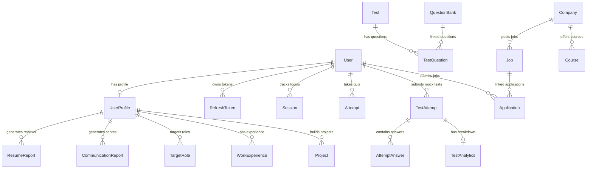

# 🚀 InterviewIQ AI (JobFit) — Next-Gen AI Career Preparation Platform

[](https://react.dev/)
[](https://www.typescriptlang.org/)
[](https://tailwindcss.com/)
[](https://nodejs.org/)
[](https://www.prisma.io/)
[](https://www.sqlite.org/)

**InterviewIQ AI** (formerly JobFit) is a premium, full-stack, gamified SaaS platform designed to transition college freshers and entry-level job seekers from "zero preparation" to "placement ready." Through AI-powered resume auditing, automated communication evaluations, timed technical assessments, and job application tracking, InterviewIQ acts as a personal career-coach-in-a-box.

---

## 🎨 Platform Preview

### 🖥️ Student Placement Readiness Dashboard


---

## 💡 Product Vision & Value Proposition

College graduates often struggle with two main hurdles: **visualizing their placement readiness** and **getting real-time, actionable feedback** on their resumes and soft skills. InterviewIQ solves this by providing:

1. **Gamified Metrics:** A single, consolidated *Placement Readiness Score* calculated from resume reviews, technical mock exams, and communication grades.
2. **Actionable AI Feedback:** Detailed ATS keyword analysis, filler-word counters, and voice speed evaluations.
3. **Structured Roadmaps:** Step-by-step company preparation paths (TCS, Infosys, Wipro, etc.) with associated modules, video lessons, flashcards, and peer discussion.
4. **End-to-End Tracking:** Keeping candidate applications organized from application draft to the final job offer.

---

## 🛠️ Technology Stack

| Layer | Technologies | Key Role in Project |
| :--- | :--- | :--- |
| **Frontend** | React 19, TypeScript, Vite, Tailwind CSS v4, Framer Motion, Recharts, Lucide Icons | Responsive UX, interactive visual charts, fluid page transitions, and dashboard analytics. |
| **Backend** | Node.js, Express, tsx (TypeScript Execution) | High-performance RESTful API endpoints, request parsing, and security middlewares. |
| **Database** | SQLite (dev) / PostgreSQL (prod), Prisma ORM | Relational models with strict cascades, optimized index lookups, and fast migrations. |
| **Auth** | JWT, Cookie-Parser, Bcrypt | Secure token-based session management, cookies, and hashed credentials. |
| **AI & Files** | Multer, PDF-Parse | Resume document upload parsing, content extraction, and mock evaluation engines. |

---

## 🌟 Key Features Walkthrough

### 1. Unified Placement Readiness Dashboard
- Integrates all assessment and analytics modules.
- Tracks learning streaks (daily active progress), targets job roles, and displays responsive Recharts metrics showing progress over time.
- Standardized UI built with a glassmorphism theme, dynamic hover state cues, and responsive viewport adapting.

### 2. AI Resume Audit Engine (`/resume`)
- Supports drag-and-drop PDF uploads via custom React hooks.
- Leverages backend text parsers to match skills, project lists, and structures against ATS metrics.
- Computes an **ATS Score (0-100)**, returns missing industry keywords (e.g. AWS, GraphQL), and suggests structural improvements.
- Saves history in the relational database so candidates can track resume quality improvement.

### 3. AI Communication & Pitch Analyzer (`/communication`)
- Evaluates verbal presentation skills (simulated through transcripts/speech inputs).
- Reports **Fluency Score**, **Confidence Score**, **Speaking Speed (words/min)**, and detects **filler words** (like *um*, *like*, *ah*).
- Renders detailed suggestions for professional pitch improvements.

### 4. Custom Timed Assessments Engine (`/assessments`)
- Timed assessment engine supporting Technical, Aptitude, Grammar, and Communication topics.
- Interactive quiz engine featuring page-leave warnings, progress saving, and instant auto-grading.
- Saves historical test attempts, scores, and analytics directly to the database.

### 5. Company Roadmaps & Course Prep (`/software-home`)
- Dedicated space containing prep guidelines, technical docs, and placement rules.
- Tracks preparation status for targeted MNCs, giving students custom learning pathways.

### 6. Pipeline Application Tracker
- Tracks jobs, saved jobs, referral requests, and interview progress.
- Users can create and transition applications through statuses: `WISHLIST`, `APPLIED`, `INTERVIEWING`, `OFFERED`, or `REJECTED`.

---

## 🗄️ Database Architecture

Below is the entity-relationship model of InterviewIQ's database, managed by Prisma ORM.



---

## 📂 Directory Structure

```text
JobFit/
├── server/                     # Node.js + Express.js Backend API
│   ├── auth.ts                 # JWT signup, login, session validation
│   ├── profile.ts              # Fetching and updating complex user profiles
│   ├── resume.ts               # Resume upload, PDF extraction, and ATS evaluation
│   ├── communication.ts        # Speech, transcript, and vocabulary analysis
│   ├── assessment.ts           # Timed tests & assessment grading
│   ├── index.ts                # App entrypoint and middleware assembly
│   ├── seedDemo.ts             # Dev seeder containing dummy accounts
│   └── prisma/
│       └── schema.prisma       # Database design schemas (SQLite/PostgreSQL)
│
├── src/                        # React 19 Frontend (Vite)
│   ├── context/
│   │   └── AuthContext.tsx     # Handles persistent auth states & HTTP interceptors
│   ├── components/
│   │   ├── Layout.tsx          # Shared responsive layout, sidebar, and theme switcher
│   │   └── UI Elements         # Reusable cards, progress bars, and modals
│   ├── pages/
│   │   ├── Dashboard.tsx       # Core candidate KPIs, charts, and activity streams
│   │   ├── Onboarding.tsx      # Step-by-step career path questionnaire
│   │   ├── ResumeAnalyzer.tsx  # Upload zone and ATS grading feedback
│   │   ├── TakeAssessment.tsx  # Timed quiz runner and active auto-grader
│   │   └── SoftwareHome.tsx    # Roadmaps, referrals list, and preparation guides
│   └── App.tsx                 # Core router containing route protections
```

---

## 💻 Elite Code Patterns

### 🔒 Standardized API Wrapper
Every backend controller responds with a consistent JSON envelope, avoiding broken state synchronization on the React side:

```typescript
// Standard success wrapper
res.status(200).json({
  success: true,
  data: resultPayload,
  message: "Resource loaded successfully."
});

// Standard error handler wrapper
res.status(400).json({
  success: false,
  error: "The request could not be processed.",
  code: "BAD_REQUEST"
});
```

### ⚡ Client-Side Route Protection
React Router wrapper automatically intercepts unauthenticated users, checks backend cookies, and ensures zero leaks of protected pages:

```tsx
const ProtectedRoute = ({ children }: { children: React.ReactNode }) => {
  const { user, isLoading } = useAuth();
  if (isLoading) return <div className="min-h-screen flex items-center justify-center">Loading...</div>;
  if (!user) return <Navigate to="/login" />;
  return <>{children}</>;
};
```

---

## 🚀 Getting Started

### Prerequisites
- Node.js (v18+)
- npm (v9+)

### Installation

1. **Clone the Repository:**
   ```bash
   git clone https://github.com/rohitvijayshukla/Jobfit-platofrm-for-freshers.git
   cd Jobfit-platofrm-for-freshers
   ```

2. **Install Dependencies:**
   ```bash
   npm install
   ```

3. **Set Up Environment Variables:**
   Create a `.env` file in the root folder:
   ```env
   DATABASE_URL="file:./dev.db"
   JWT_SECRET="supersecret_recruitertestkey_2026"
   PORT=5000
   ```

4. **Initialize Database Schema (Prisma):**
   ```bash
   npx prisma db push
   ```

5. **Seed Demo Candidate Data:**
   ```bash
   npx tsx server/seedDemo.ts
   ```
   *This seeds a mock candidate profile (`demo@gmail.com` with password `password123`) containing a pre-completed profile, resume report history, and mock communication analysis.*

6. **Start the Concurrent Dev Servers (Frontend + Backend):**
   ```bash
   npm run dev
   ```

7. **Access the application:**
   - Frontend: `http://localhost:5173` (or as displayed in your terminal console)
   - Backend API: `http://localhost:5000`

---

## 🌟 Why This Project Demonstrates Placement Readiness

- **Production-grade Database Design:** Cascading deletes, models for learning tracking, custom evaluations, and version controls.
- **Strict TypeScript Typing:** Complete end-to-end types, minimizing unexpected production crashes.
- **Beautiful UX:** Dynamic micro-animations built using Framer Motion and modern color palettes that provide a clean, executive feel rather than a basic boot camp project.
